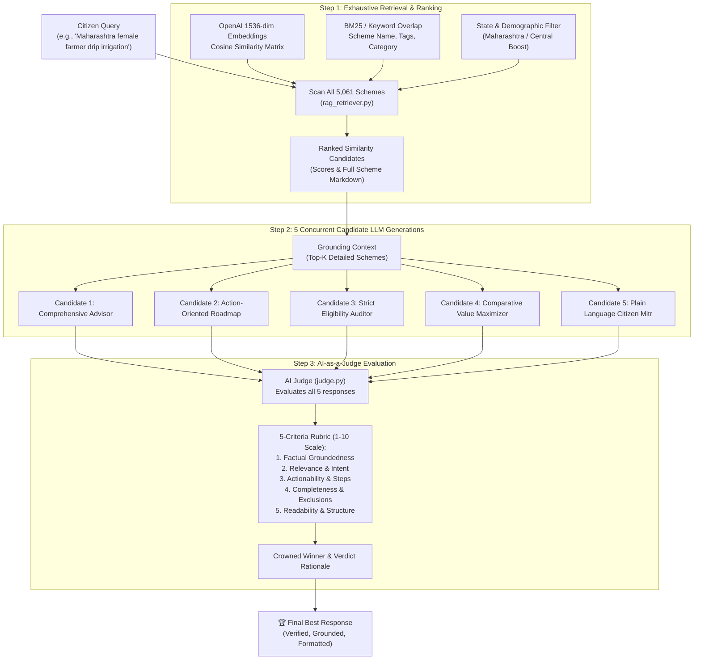

# 🌾 GramSathi: Intelligent Welfare RAG with Multi-LLM Personas & AI-as-a-Judge

An advanced Retrieval-Augmented Generation (RAG) system covering **5,061 Indian Government Welfare Schemes** (Central and State).

---

## 🌟 Architecture & Workflow



---

## 🚀 Quick Start

### 1. Environment & API Key
The OpenAI API key is securely stored in `.env`:
```env
OPENAI_API_KEY=sk-proj-...
```

### 2. Pre-indexed Cache
All 5,061 schemes are pre-indexed into `rag_cache/`:
- `rag_cache/scheme_embeddings.npy` (5,061 x 1536 normalized embeddings matrix)
- `rag_cache/schemes_store.json` (Parsed documents store)

To re-index anytime:
```bash
python3 index_dataset.py
```

### 3. Run the Interactive Web UI
The Web UI is hosted on `http://localhost:8000`:
```bash
uvicorn app:app --host 0.0.0.0 --port 8000
```
Open `http://localhost:8000` in your browser.

Features:
- **Exhaustive Similarity Browser**: View similarity scores across all matched schemes.
- **5 Candidate Responses**: Compare all 5 generation styles side-by-side.
- **AI Judge Scorecard**: Interactive table showing scores on Groundedness, Relevance, Actionability, Completeness, Clarity, and the official verdict.
- **Final Best Response**: Clean markdown output ready for the citizen.

### 4. Run via Command Line Interface (CLI)

Run a single query:
```bash
python3 cli.py --query "I am a female farmer from Maharashtra looking for drip irrigation subsidy and crop insurance"
```

Show all 5 candidates, similarity scores, and judge breakdown:
```bash
python3 cli.py --query "Karnataka SC student engineering scholarship" --show-all-candidates --show-similarities --show-judge-scores
```

Run interactive chat mode:
```bash
python3 cli.py --interactive
```

### 5. Python API Usage
```python
from rag_pipeline import SchemeRAGPipeline

pipeline = SchemeRAGPipeline()
result = pipeline.run("dairy farming loan subsidy for unemployed youth in Bihar")

print("Winner:", result["winner_id"])
print("Similarities found:", result["similarities_count"])
print("Judge Verdict:", result["judge_evaluation"]["judge_verdict"])
print("\nFinal Best Response:\n", result["final_best_response"])
```

---

## 📁 Repository Structure

- [prepare_rag_dataset.py](file:///home/sopnic/project/GramSathi/prepare_rag_dataset.py): ETL extracting full markdown details (benefits, eligibility, application processes) from [schemes_detailed.json](file:///home/sopnic/project/GramSathi/schemes_detailed.json).
- [index_dataset.py](file:///home/sopnic/project/GramSathi/index_dataset.py): Batch indexing script using OpenAI `text-embedding-3-small`.
- [rag_retriever.py](file:///home/sopnic/project/GramSathi/rag_retriever.py): Hybrid similarity search (dense cosine + lexical BM25 + geographic multiplier).
- [generator.py](file:///home/sopnic/project/GramSathi/generator.py): 5 parallel candidate response generators.
- [judge.py](file:///home/sopnic/project/GramSathi/judge.py): LLM-as-a-Judge evaluation engine and rubric scorer.
- [rag_pipeline.py](file:///home/sopnic/project/GramSathi/rag_pipeline.py): End-to-end pipeline orchestrator.
- [cli.py](file:///home/sopnic/project/GramSathi/cli.py): Rich terminal interface.
- [app.py](file:///home/sopnic/project/GramSathi/app.py): FastAPI web application and UI.
